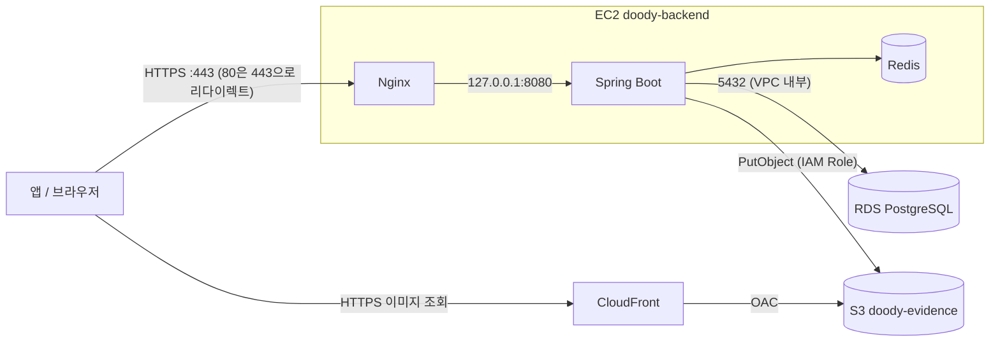
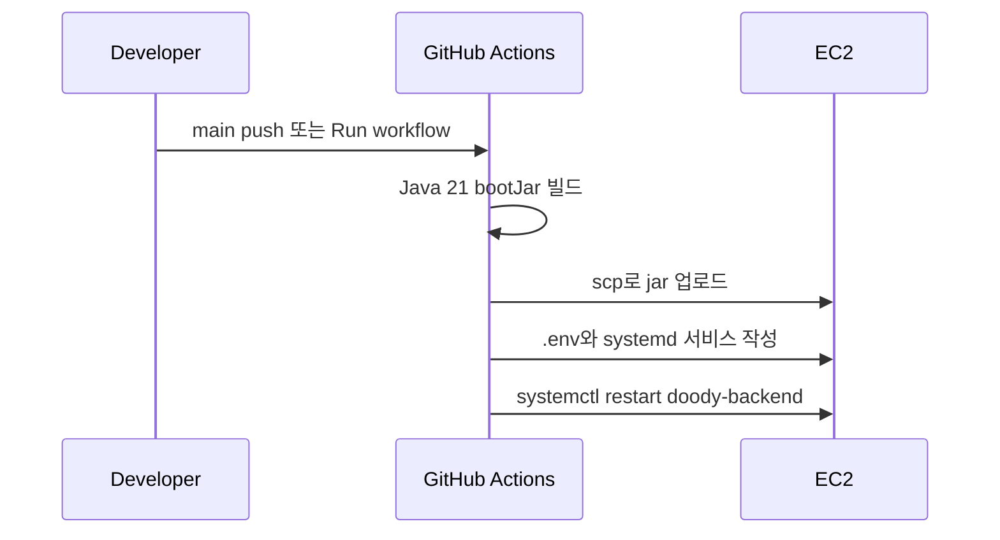

# AWS + GitHub Actions 백엔드 배포 가이드

최초 작성: 2026-07-04  
전면 개정: 2026-11-23 (AWS 재구축, 시드니 리전, Nginx, CloudFront, HTTPS 추가)  
대상: Spring Boot 백엔드 jar 배포 (포트폴리오용, 정식 출시 계획 없음)

## 1. 전체 구성

| 항목 | 값 |
|---|---|
| 리전 | `ap-southeast-2` (아시아 태평양 · 시드니) |
| API 주소 | `https://doody-api.duckdns.org/api` (Nginx 443 → Spring 8080) |
| Swagger | `https://doody-api.duckdns.org/swagger-ui/index.html` |
| 도메인 | `doody-api.duckdns.org` (DuckDNS 무료 서브도메인 → `3.24.77.23`) |
| 인증서 | Let's Encrypt (certbot, 90일, 자동 갱신) |
| 이미지 주소 | `https://d20ic6nyseo37c.cloudfront.net/doody/mission/...` |
| EC2 | `doody-backend`, Ubuntu 24.04, t3.small, 탄력적 IP `3.24.77.23` |
| RDS | `doody-db`, PostgreSQL, db.t4g.micro, 초기 DB `doody`, 퍼블릭 액세스 없음 |
| S3 | `doody-evidence` (퍼블릭 액세스 차단 유지) |
| CloudFront | 배포 `E1KE0EYTPC1U0Y`, OAC로 S3 접근 |
| Redis | EC2 내부 설치 (`127.0.0.1:6379`, 외부 미노출) |

서울 리전은 무료 플랜에서 제한되어 시드니를 사용한다. 서울로 옮기려면 계정 플랜을 업그레이드한 뒤 이 문서 순서대로 다시 구성하고 RDS 데이터와 S3 객체를 옮긴다.





## 2. 보안그룹

| 이름 | 인바운드 | 비고 |
|---|---|---|
| `doody-ec2-sg` | SSH 22, HTTP 80, HTTPS 443 (모두 `0.0.0.0/0`) | GitHub Actions IP가 고정이 아니어서 22를 전체 허용. 접속은 키 인증만 가능 |
| `doody-rds-sg` | PostgreSQL 5432, 소스 = `doody-ec2-sg` | 절대 `0.0.0.0/0`으로 열지 않는다 |

8080은 열지 않는다. 모든 요청은 Nginx(443, 80은 리다이렉트와 인증서 발급·갱신용)를 거친다.

## 3. S3 + CloudFront

### 3-1. S3 버킷

- 이름 `doody-evidence`, 리전 시드니, 글로벌 네임스페이스
- ACL 비활성화, **모든 퍼블릭 액세스 차단 유지**, SSE-S3 암호화

### 3-2. CloudFront

- 원본: `doody-evidence.s3.ap-southeast-2.amazonaws.com` (`s3-website` 주소 아님)
- 원본 액세스: OAC (CloudFront에 대한 프라이빗 S3 버킷 액세스 허용)
- 뷰어 프로토콜: Redirect HTTP to HTTPS, 캐시: S3 기본 권장 설정, WAF 없음

버킷 정책에는 CloudFront 배포만 읽을 수 있게 하는 정책이 자동으로 들어간다.

```json
{
  "Effect": "Allow",
  "Principal": { "Service": "cloudfront.amazonaws.com" },
  "Action": "s3:GetObject",
  "Resource": "arn:aws:s3:::doody-evidence/*",
  "Condition": {
    "ArnLike": { "AWS:SourceArn": "arn:aws:cloudfront::<ACCOUNT_ID>:distribution/E1KE0EYTPC1U0Y" }
  }
}
```

### 3-3. 이미지 URL 동작

`S3FileStorageService.publicUrl()`은 `S3_PUBLIC_BASE_URL`이 있으면 그 주소를 기준으로 URL을 만든다. 비어 있으면 S3 직접 주소를 반환하는데, 버킷이 비공개라서 `AccessDenied`가 난다. 따라서 **`S3_PUBLIC_BASE_URL`은 반드시 CloudFront 주소로 설정한다.**

```env
S3_PUBLIC_BASE_URL=https://d20ic6nyseo37c.cloudfront.net
```

끝에 `/`를 붙이지 않는다.

## 4. EC2 IAM Role

- 역할 이름: `doody-app-ec2-role` (신뢰 엔터티: EC2)
- 인라인 정책 `DoodyMissionEvidenceS3Policy`:

```json
{
  "Version": "2012-10-17",
  "Statement": [
    {
      "Sid": "DoodyMissionEvidenceUpload",
      "Effect": "Allow",
      "Action": ["s3:PutObject", "s3:GetObject"],
      "Resource": "arn:aws:s3:::doody-evidence/doody/mission/*"
    }
  ]
}
```

코드는 `DefaultCredentialsProvider`로 이 역할을 자동 인식한다. EC2와 GitHub Secrets 어디에도 AWS Access Key를 넣지 않는다.

## 5. RDS

- 생성 방식: **전체 구성** (빠른 구성/손쉬운 생성 사용 안 함)
- 엔진: **PostgreSQL** (Aurora 아님), 템플릿: 프리 티어, 단일 AZ
- 자격 증명 관리: **자체 관리** (Secrets Manager 사용 안 함)
- 스토리지: gp3 20GiB, 자동 조정 끔
- 연결: EC2 컴퓨팅 리소스에 연결 안 함, 퍼블릭 액세스 아니요, 인터넷 액세스 게이트웨이 비활성화, 보안그룹 `doody-rds-sg`
- 추가 구성: **초기 데이터베이스 이름 `doody`** (비워 두면 DB가 생성되지 않음), 삭제 방지 켬

`application-prod.yml`이 `sslmode=require`를 사용하며 RDS는 이를 지원한다. 테이블은 `ddl-auto: update`로 첫 기동 시 생성된다.

## 6. EC2 최초 1회 준비

### 6-1. 인스턴스

- Ubuntu Server 24.04 LTS (x86), t3.small, gp3 20GiB
- 키 페어 `doody-key` (RSA, .pem), 보안그룹 `doody-ec2-sg`
- 고급 세부 정보의 IAM 인스턴스 프로파일: `doody-app-ec2-role`
- 탄력적 IP를 할당해 연결한다 (연결하지 않은 탄력적 IP는 과금된다)

### 6-2. 패키지 설치

```bash
sudo apt update && sudo apt upgrade -y
sudo apt install -y openjdk-21-jre-headless redis-server nginx
```

swap 2GB:

```bash
sudo fallocate -l 2G /swapfile && sudo chmod 600 /swapfile && sudo mkswap /swapfile && sudo swapon /swapfile && echo '/swapfile none swap sw 0 0' | sudo tee -a /etc/fstab
```

확인:

```bash
java -version
redis-cli ping            # PONG
free -h                   # Swap 2.0Gi
nc -zv <RDS_ENDPOINT> 5432  # succeeded!
```

`doody` 사용자, `/opt/doody/.env`, systemd 서비스는 GitHub Actions workflow가 배포할 때마다 자동으로 작성하므로 직접 만들 필요가 없다.

### 6-3. Nginx

```bash
sudo tee /etc/nginx/sites-available/doody > /dev/null << 'EOF'
server {
    listen 80 default_server;
    server_name _;
    client_max_body_size 20M;

    location / {
        proxy_pass http://127.0.0.1:8080;
        proxy_set_header Host $host;
        proxy_set_header X-Real-IP $remote_addr;
        proxy_set_header X-Forwarded-For $proxy_add_x_forwarded_for;
        proxy_set_header X-Forwarded-Proto $scheme;
        proxy_read_timeout 120s;
    }
}
EOF
sudo rm -f /etc/nginx/sites-enabled/default
sudo ln -sf /etc/nginx/sites-available/doody /etc/nginx/sites-enabled/doody
sudo nginx -t && sudo systemctl reload nginx
```

- `client_max_body_size 20M`: 증빙 이미지 업로드 허용 크기
- `proxy_read_timeout 120s`: AI 엔진 응답 지연 대비
- `X-Forwarded-Proto`: Spring이 원래 요청이 HTTPS였는지 알 수 있게 전달 (6-4의 `forward-headers-strategy`와 짝)

### 6-4. HTTPS (DuckDNS + Let's Encrypt)

도메인을 구매하지 않고 DuckDNS 무료 서브도메인에 Let's Encrypt 인증서를 붙인다.

1. https://www.duckdns.org 에 로그인 → 서브도메인 `doody-api` 추가
2. 목록의 **current ip**를 `3.24.77.23`으로 바꾸고 **update ip** (기본값은 내 PC IP이므로 반드시 변경)
3. DNS 확인: `nslookup doody-api.duckdns.org` → `3.24.77.23`

탄력적 IP라 IP가 바뀌지 않으므로 DuckDNS 자동 갱신 스크립트는 설치하지 않는다. DuckDNS token은 공유하지 않는다.

서버에서 Nginx `server_name`을 도메인으로 바꾸고 인증서를 발급한다.

```bash
sudo sed -i 's/server_name _;/server_name doody-api.duckdns.org;/' /etc/nginx/sites-available/doody
sudo nginx -t && sudo systemctl reload nginx

sudo apt install -y certbot python3-certbot-nginx
sudo certbot --nginx -d doody-api.duckdns.org   # 이메일 입력, 약관 동의, 리다이렉트 선택
sudo certbot renew --dry-run                     # 자동 갱신 테스트
```

certbot이 `/etc/nginx/sites-available/doody`를 직접 수정한다.

- `listen 443 ssl`과 인증서 경로(`/etc/letsencrypt/live/doody-api.duckdns.org/`) 추가
- 80 포트 요청은 `https://`로 301 리다이렉트
- **도메인이 아닌 Host(예: `http://3.24.77.23`)로 들어온 요청은 404**를 반환한다. API는 반드시 도메인으로 호출한다.

인증서는 90일짜리이며 certbot이 설치한 systemd timer가 만료 전에 자동 갱신한다 (`systemctl list-timers | grep certbot`).

Spring 쪽에는 `application-prod.yml`에 아래 설정이 있어야 Nginx가 넘겨 준 `X-Forwarded-*` 헤더를 읽는다. 없으면 Swagger가 서버 주소를 `http://`로 만들어 HTTPS 페이지에서 Try it out이 막힌다.

```yaml
server:
  forward-headers-strategy: framework
```

확인: `curl -s https://doody-api.duckdns.org/v3/api-docs | grep -o '"servers":\[[^]]*\]'` → `https://doody-api.duckdns.org`

새 서버로 옮기거나 IP가 바뀌면 DuckDNS의 current ip를 새 IP로 바꾸고, 새 서버에서 6-3 → 6-4를 다시 실행한다.

## 7. GitHub Secrets

위치: `Settings -> Secrets and variables -> Actions`

| Secret | 값 | 비고 |
|---|---|---|
| `EC2_HOST` | `3.24.77.23` | 탄력적 IP |
| `EC2_USERNAME` | `ubuntu` | 오타 주의 (`ubunto`로 넣어 배포가 실패한 적 있음) |
| `EC2_SSH_KEY` | `doody-key.pem` 전체 내용 | 아래 등록 방법 참고 |
| `DB_HOST` | RDS 엔드포인트 | |
| `DB_NAME` | `doody` | |
| `DB_USERNAME` / `DB_PASSWORD` | RDS 마스터 계정 | |
| `AWS_REGION` | `ap-southeast-2` | |
| `S3_BUCKET` | `doody-evidence` | |
| `S3_PUBLIC_BASE_URL` | `https://d20ic6nyseo37c.cloudfront.net` | 끝에 `/` 없음 |
| `HANA_AUTONOMY_URL` | `https://www.hanafn.com` | **반드시 등록** |
| `HANA_CONNECTION_URL` | `https://www.hanafn.com` | **반드시 등록** |
| `AI_ENGINE_BASE_URL` | AI 엔진 주소 | |

workflow는 등록되지 않은 시크릿을 **빈 값**으로 `.env`에 쓴다. yml의 `${VAR:기본값}`은 변수가 아예 없을 때만 적용되고 빈 값이면 적용되지 않으므로, 기본값이 있는 항목도 시크릿으로 등록한다.

`EC2_SSH_KEY`는 복사·붙여넣기 대신 파일을 그대로 등록한다. 메모장을 거치면 줄바꿈이 깨져 `error in libcrypto`가 날 수 있다.

```powershell
Get-Content -Raw "$HOME\.ssh\doody-key.pem" | gh secret set EC2_SSH_KEY --repo HanaDoody/doody-backend
```

## 8. GitHub Actions 자동 배포

파일 위치:

```txt
.github/workflows/deploy-ec2.yml
```

동작 조건:

| 조건 | 설명 |
|---|---|
| `main` 브랜치 push + 아래 경로 중 하나 이상 변경 | 자동 배포 실행 |
| `workflow_dispatch` | `Actions -> Deploy Spring Backend to EC2 -> Run workflow`로 수동 실행 (경로 필터 영향 없음) |

자동 배포 대상 경로 (`paths` 허용 목록):

```yml
paths:
  - "src/**"
  - "build.gradle"
  - "settings.gradle"
  - "gradle/**"
  - "gradlew"
  - ".github/workflows/deploy-ec2.yml"
```

`README.md`, `docs/`, `tools/`, 백업 폴더 등 jar에 들어가지 않는 파일만 바뀐 push는 배포하지 않는다. 한 push에 코드와 문서가 섞여 있으면 배포한다. jar 빌드에 영향을 주는 새 파일/폴더를 추가하면 이 목록에도 추가한다.

다른 브랜치에서 배포하려면 workflow의 branches 값을 바꾼다.

```yml
on:
  push:
    branches:
      - refactor/#14
```

workflow 단계:

1. Java 21(temurin) 설정 후 `./gradlew clean bootJar -x test`
2. `EC2_SSH_KEY`로 jar를 `/tmp/doody-backend.jar`에 업로드
3. EC2에서 `doody` 사용자 생성(없을 때), jar를 `/opt/doody/app.jar`로 이동
4. 시크릿으로 `/opt/doody/.env` 작성 (9장 참고, `chmod 600`)
5. `/etc/systemd/system/doody-backend.service` 작성 후 `systemctl restart doody-backend`

주의:

- 코드 변경 없이 **시크릿만 바꾼 경우**에는 push가 없으므로 수동 실행해야 서버 `.env`에 반영된다.
- 경로 필터에 걸려 배포되지 않았는데 배포가 필요하면 수동 실행한다.
- `paths`와 `paths-ignore`는 함께 쓸 수 없다.

## 9. 서버 환경변수 (`/opt/doody/.env`)

workflow가 배포할 때마다 아래 내용으로 덮어쓴다. **실제 값은 GitHub Secrets에만 두고 문서와 코드에는 적지 않는다.** 서버에서 `.env`를 직접 고쳐도 다음 배포 때 사라지므로, 값 변경은 항상 시크릿에서 한다.

```env
SPRING_PROFILES_ACTIVE=prod
DB_HOST=<RDS 엔드포인트>
DB_NAME=doody
DB_USERNAME=<RDS 마스터 사용자>
DB_PASSWORD=<RDS 마스터 암호>
AI_ENGINE_BASE_URL=<AI 엔진 주소>
AWS_REGION=ap-southeast-2
S3_BUCKET=doody-evidence
S3_PUBLIC_BASE_URL=https://d20ic6nyseo37c.cloudfront.net
HANA_AUTONOMY_URL=https://www.hanafn.com
HANA_CONNECTION_URL=https://www.hanafn.com
```

| 변수 | 사용처 (`application-prod.yml`) |
|---|---|
| `SPRING_PROFILES_ACTIVE` | workflow에 `prod`로 고정 |
| `DB_HOST`, `DB_NAME`, `DB_USERNAME`, `DB_PASSWORD` | `spring.datasource.*` (`sslmode=require`) |
| `AI_ENGINE_BASE_URL` | `ai.engine.base-url` |
| `AWS_REGION` | `cloud.aws.region.static` |
| `S3_BUCKET` | `cloud.aws.s3.bucket` |
| `S3_PUBLIC_BASE_URL` | `cloud.aws.s3.public-base-url` (이미지 URL 기준 주소) |
| `HANA_AUTONOMY_URL`, `HANA_CONNECTION_URL` | `hana.finance.*` |

`AWS_ACCESS_KEY_ID`, `AWS_SECRET_ACCESS_KEY`는 넣지 않는다. S3 권한은 EC2 IAM Role이 담당한다.

새 환경변수를 추가할 때는 세 곳을 함께 수정한다.

1. `application-prod.yml`에 `${NEW_VAR}` 참조 추가
2. GitHub Secrets에 `NEW_VAR` 등록
3. `deploy-ec2.yml`의 `ENVEOF` 블록에 `NEW_VAR=${{ secrets.NEW_VAR }}` 추가

예정: 로그인 작업 시 `JWT_SECRET`, `GOOGLE_CLIENT_IDS`, `REDIS_HOST`(`localhost`)를 위 절차로 추가한다.

## 10. 배포 확인

```bash
sudo systemctl status doody-backend --no-pager
journalctl -u doody-backend -n 100 --no-pager -l
curl http://localhost:8080/api/health
sudo grep S3_PUBLIC_BASE_URL /opt/doody/.env
```

외부:

```bash
curl https://doody-api.duckdns.org/api/health
```

인증서 만료일:

```bash
sudo certbot certificates
```

## 11. 로컬에서 서버 접속 (Windows)

```powershell
ssh -i "$HOME\.ssh\doody-key.pem" ubuntu@3.24.77.23
```

`UNPROTECTED PRIVATE KEY FILE` / `bad permissions`가 나오면 키 파일 권한을 본인만 읽을 수 있게 정리한다. 경고에 표시된 다른 사용자/그룹도 함께 제거한다.

```powershell
icacls "$HOME\.ssh\doody-key.pem" /inheritance:r /grant:r "$($env:USERNAME):(R)"
```

키 파일 없이 접속해야 하면 콘솔의 `EC2 -> 인스턴스 -> 연결 -> EC2 Instance Connect`를 사용한다.

## 12. 자주 나는 오류

| 증상 | 원인 | 해결 |
|---|---|---|
| Actions `Load key ... error in libcrypto` | `EC2_SSH_KEY` 내용이 깨짐 | 7장 방법으로 파일째 다시 등록 |
| Actions `Permission denied (publickey)` | 사용자명 오타 또는 키 불일치 | 서버에서 `sudo journalctl -u ssh --since "30 min ago"` 확인. `Invalid user xxx`면 `EC2_USERNAME` 수정 |
| `Unit doody-backend.service could not be found` | 배포가 아직 성공하지 않음 | Actions 실행 결과 확인 |
| DB 연결 실패 | `.env` DB 값 오류 또는 보안그룹 문제 | `nc -zv <RDS_ENDPOINT> 5432`, `doody-rds-sg` 소스 확인 |
| `database "doody" does not exist` | RDS 초기 DB 이름 누락 | RDS에서 DB 생성 또는 재구성 |
| S3 업로드 실패 | IAM Role 미연결 또는 정책의 버킷명 불일치 | 인스턴스의 IAM 역할과 정책 Resource 확인 |
| 이미지 URL `AccessDenied` | `S3_PUBLIC_BASE_URL` 미설정 (S3 직접 주소 반환) | CloudFront 주소로 설정 후 재배포 |
| CloudFront `AccessDenied` | 버킷 정책에 CloudFront 허용 없음 | 3-2 버킷 정책 확인 |
| 외부에서 접속 안 됨 | Nginx 설정 또는 보안그룹 80/443 미개방 | `sudo nginx -t`, `doody-ec2-sg` 확인 |
| `http://3.24.77.23/...` 404 | certbot 설정 후 도메인 Host만 처리 | `https://doody-api.duckdns.org`로 호출 |
| 도메인 접속 안 됨 (`NXDOMAIN`, 다른 IP) | DuckDNS current ip 불일치 | `nslookup doody-api.duckdns.org` 후 DuckDNS에서 IP 수정 |
| certbot 발급 실패 | DNS 미반영, 80 포트 차단, `server_name` 불일치 | DNS·보안그룹·Nginx `server_name` 확인 후 재시도 |
| Swagger Try it out 실패 (Mixed Content) | Spring이 HTTPS를 인식하지 못함 | `server.forward-headers-strategy: framework` 확인 |
| 프론트(HTTPS 웹)에서 API 호출 차단 | API를 `http://`로 호출 | API 주소를 `https://doody-api.duckdns.org/api`로 변경 |

## 13. 운영 메모

- 클라이언트 API 주소는 `https://doody-api.duckdns.org/api`. HTTPS이므로 앱의 HTTP 허용 설정(Android `usesCleartextTraffic`, iOS ATS 예외)은 필요 없다.
- DuckDNS는 외부 무료 서비스라 장애 시 도메인 접속이 안 될 수 있다. 정식 서비스가 필요해지면 도메인을 구매해 6-4를 해당 도메인으로 다시 실행한다.
- 보안 업데이트는 `unattended-upgrades`로 자동 설치된다 (`systemctl is-enabled unattended-upgrades`).
- 루트 계정과 IAM 사용자 모두 MFA를 사용하고, 월 예산 알림을 유지한다.
- 사용하지 않는 기간에는 EC2/RDS를 중지할 수 있다. RDS는 중지 7일 후 자동으로 다시 시작된다.
- 프로젝트 종료 시 정리 순서: CloudFront 비활성화·삭제 → RDS 삭제(삭제 방지 해제) → EC2 종료 → 탄력적 IP 릴리스 → S3 비우고 삭제 → IAM 역할 삭제.
